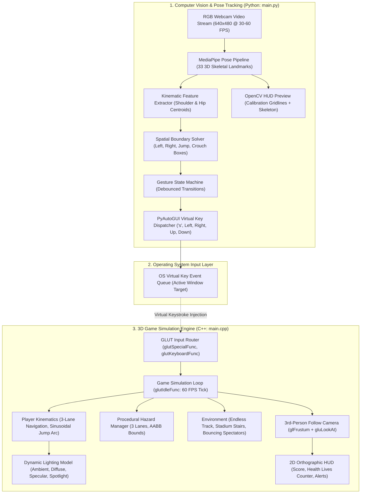

# CyberRunner 3D — Real-Time AI Vision Endless Runner & Gesture Control Engine

[](https://isocpp.org/)
[](https://developers.google.com/mediapipe)
[](https://www.python.org/)
[](#-3d-game-simulation-engine)
[](#-dual-process-system-architecture)
[](#)

---

## 🎮 Executive Summary

**CyberRunner 3D** is an interactive, low-latency Human-Computer Interaction (HCI) gaming system that bridges a **3D OpenGL/GLUT endless runner game** with a **real-time AI computer vision optical tracking pipeline**. 

Instead of traditional gamepads or keyboards, the player uses their body as the controller. A standard consumer webcam captures full-body motion, processes skeletal landmarks in real time via **Google MediaPipe Pose**, classifies biomechanical postures (lateral leans, jumps, ducks, and hand raises) through a state machine, and injects low-latency virtual keystrokes directly into the OpenGL game engine.

The system is designed with a synchronized **dual-process architecture**:
1. **3D OpenGL Game (`main.cpp`)**: A C++ simulation featuring real-time 3D rendering, sinusoidal jump kinematics, 3-lane procedural obstacle hazard generation, dynamic illumination models (point and spot lights), animated stadium spectator crowds with bounce physics, and a 2D orthographic heads-up display (HUD).
2. **AI Optical Vision Controller (`main.py`)**: A Python computer vision pipeline utilizing OpenCV and MediaPipe Pose to capture 33 3D skeletal landmarks at 30–60 FPS, calculate torso/shoulder centroids, evaluate spatial boundary boxes, and dispatch debounced input actions via PyAutoGUI.

---

## 🏛️ System Architecture

The project operates through two decoupled, asynchronous processes communicating via OS-level virtual input event injection:



---

## ⚡ Key Technical Features

### 1. 3D Game Simulation Engine (`main.cpp`)
- **Discrete 3-Lane Track Model**: Symmetrical multi-lane navigation with player positions at lateral offsets $X \in \{-1.4, 0.0, +1.4\}$.
- **Sinusoidal Jump Kinematics**: Natural vertical leap trajectory modeled with harmonic sinusoidal elevation:
  $$y(t) = y_{\text{base}} + \sin(\theta_t), \quad \theta_t \in [0, \pi]$$
- **Procedural Hazard Generation**: Continuous pseudo-random obstacle arrays generated ahead of the player across all three lanes.
- **Axis-Aligned Bounding Box (AABB) Collision**: Rapid spatial intersection tests between the player and obstacles with a built-in immunity frame buffer (`immunity = 7`) to prevent multi-hit depletion.
- **Dynamic 3D Camera System**: 3rd-person follow camera positioned dynamically behind and above the player using `gluLookAt` coupled with perspective frustum projection.
- **Dynamic Lighting & Shading**: Configured with `GL_LIGHT0` (directional/ambient light) and `GL_LIGHT1` (focused spotlight with cutoff angles and exponent attenuation), along with ambient, diffuse, and specular material reflections.
- **Animated Stadium Environment**: Endless ground geometry bounded by tiered stadium bleachers and procedural spectators with phase-shifted bouncing motion.
- **2D Orthographic HUD Overlay**: Real-time rendering of player score (distance traveled along $-Z$) and health hearts/lives counter.

### 2. AI Computer Vision Pose Controller (`main.py`)
- **33-Point Skeletal Keypoint Detection**: Utilizes Google MediaPipe Pose to estimate 3D body keypoints with sub-pixel landmark precision.
- **Torso & Shoulder Centroid Tracking**: Computes normalized body midpoint coordinates $(x, y)$ by averaging left/right shoulder (landmarks 11 & 12) and hip keypoints.
- **Dynamic Boundary Partitioning**: Screen space is mapped into normalized calibration zones:
  - **Left Boundary**: $x > 0.6$ (mirrored selfie camera perspective)
  - **Right Boundary**: $x < 0.4$
  - **Top Jump Boundary**: $y < 0.4$
  - **Bottom Crouch Boundary**: $y > 0.6$
  - **Center Deadzone**: $0.4 \le x \le 0.6$ and $0.4 \le y \le 0.6$ (prevents lateral jitter/oscillation)
- **Contact-Free Start Trigger**: Raising the right hand (wrist landmark 16) above the upper boundary activates game initialization by sending `'s'`.
- **Hysteresis State Transitions**: Prevents repeated rapid triggering and ensures smooth lane recentering when returning to the neutral deadzone.
- **On-Screen Optical HUD**: Real-time OpenCV feedback window displaying the calibration grid, player centroid, and skeletal connections.

---

## 📂 Repository Structure

```
.
├── main.cpp                # 3D Endless Runner Game Engine (C++ / OpenGL / GLUT)
├── main.py                 # AI Pose & Gesture Tracking Controller (Python / MediaPipe / OpenCV)
├── Project Report.pdf      # Detailed Project Research & Engineering Report
├── README.md               # Main repository documentation & architecture overview
└── run_instructions.md     # Step-by-step build, execution, and troubleshooting guide
```

---

## 🧘 Body Gesture & Control Mapping

The AI Vision Controller maps physical body movements into game controls in real time:

| In-Game Action | Biomechanical Gesture | Optical Trigger Condition | Virtual Key Injected |
| :--- | :--- | :--- | :---: |
| **Start / Restart** | **Raise Right Hand** | Right wrist ($Y_{16}$) elevated above top boundary ($y < 0.4$) | `'s'` |
| **Shift Left Lane** | **Lean Body Left** | Torso centroid shifts to player's left ($x > 0.6$) | `Left Arrow` |
| **Shift Right Lane** | **Lean Body Right** | Torso centroid shifts to player's right ($x < 0.4$) | `Right Arrow` |
| **Recenter Lane** | **Return to Center** | Torso returns into the central deadzone ($0.4 \le x \le 0.6$) | Compensatory key |
| **Jump Obstacle** | **Jump / Stand Tall** | Torso elevation crosses top boundary line ($y < 0.4$) | `Up Arrow` |
| **Crouch / Duck** | **Squat / Crouch** | Torso lowers below bottom boundary line ($y > 0.6$) | `Down Arrow` |

### Manual Keyboard Fallback Controls
The C++ game also supports direct manual keyboard input at any time:
- `'s'`: Start game from title screen
- `Left Arrow` / `Right Arrow`: Switch lateral lanes
- `Up Arrow`: Jump over incoming obstacles

---

## 🚀 Quickstart Guide

For comprehensive platform-specific instructions, see **[run_instructions.md](file:///f:/G/Sunny/Projects/Endless%20runner/run_instructions.md)**.

### 1. Compile the C++ 3D Game Engine

```bash
# Windows (MinGW)
g++ -std=c++17 -O2 main.cpp -lopengl32 -lglu32 -lfreeglut -o cyber_runner.exe

# Linux (GCC / Clang)
g++ -std=c++17 -O2 main.cpp -lGL -lGLU -lglut -o cyber_runner

# macOS (Clang with Native Frameworks)
clang++ -std=c++17 -O2 main.cpp -framework OpenGL -framework GLUT -o cyber_runner
```

### 2. Set Up Python Environment & Run AI Controller

```bash
# 1. Create and activate virtual environment
python -m venv .venv
# On Windows: .\.venv\Scripts\activate
# On Linux/macOS: source .venv/bin/activate

# 2. Install required packages
pip install opencv-python mediapipe pyautogui

# 3. Launch AI gesture controller
python main.py
```

### 3. Play the Game!
1. Start the compiled C++ game executable in one terminal.
2. Start `python main.py` in a second terminal.
3. **Click inside the 3D Game window** to ensure it has operating system focus.
4. Raise your right hand to start the run!

---

## 📄 Documentation Reference

- **[run_instructions.md](file:///f:/G/Sunny/Projects/Endless%20runner/run_instructions.md)**: Exhaustive build steps, platform prerequisites, camera calibration guidelines, and detailed troubleshooting matrix.
- **[Project Report.pdf](file:///f:/G/Sunny/Projects/Endless%20runner/Project%20Report.pdf)**: Formal academic research paper documenting the vision tracking theory, HCI design principles, and performance benchmarks.
