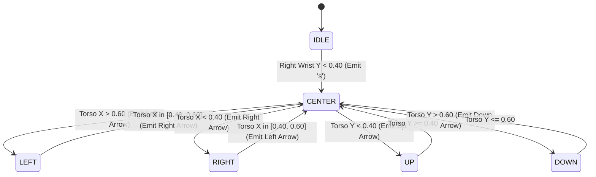

# CyberRunner 3D — Biomechanical Gesture Recognition & Dispatch Protocol

## 1. Coordinate Frame Transformations

### 1.1 Camera Space vs. Mirror Selfie Space
Webcams record in direct camera coordinate space, where the subject's left arm appears on the image's right. To provide intuitive human feedback, the controller executes a horizontal flip ($X_{\text{mirrored}} = 1.0 - X_{\text{camera}}$) for display, while internally operating on normalized sensor coordinates:
- $X \in [0.0, 1.0]$: Left-to-right axis across the camera sensor
- $Y \in [0.0, 1.0]$: Top-to-bottom axis across the camera sensor (0.0 = top of frame, 1.0 = bottom)

```
(0.0, 0.0) ----------------------------- (1.0, 0.0)
     |                                         |
     |         TOP BOUNDARY (Y = 0.40)         |
     |-----------------------------------------|
     |   RIGHT   |    CENTER    |     LEFT     |
     |  (X<0.40) |   DEADZONE   |   (X>0.60)   |
     |-----------------------------------------|
     |        BOTTOM BOUNDARY (Y = 0.60)       |
     |                                         |
(0.0, 1.0) ----------------------------- (1.0, 1.0)
```

---

## 2. Boundary Calibration Metrics

| Boundary | Normalized Threshold | Physical Meaning |
| :--- | :--- | :--- |
| `boundary_top` | `0.40` | Upper boundary for jump detection & hand-raise game start. |
| `boundary_bottom` | `0.60` | Lower boundary for squat / duck / crouch detection. |
| `boundary_left` | `0.60` | Lateral threshold for physical lean to user's left. |
| `boundary_right` | `0.40` | Lateral threshold for physical lean to user's right. |
| `deadzone_center` | `[0.40, 0.60]` | Neutral corridor where no lateral movement is triggered. |

---

## 3. Finite State Machine (FSM) Transitions



### 3.1 Recenter Hysteresis
To ensure that physical movement maps naturally to discrete 3-lane gameplay, shifting into `LEFT` moves the player left by 1 lane. When the user returns their body to `CENTER`, the FSM emits a compensatory move to restore the player to the center lane, ensuring zero drift over extended gameplay runs.

### 3.2 Cooldown & Rate Limiting
- **Jump Cooldown**: `350 ms` refractory period prevents double-triggering during multi-frame jump elevation.
- **Lane Change Cooldown**: `200 ms` refractory window prevents rapid lane oscillation during rapid body weight shifts.
